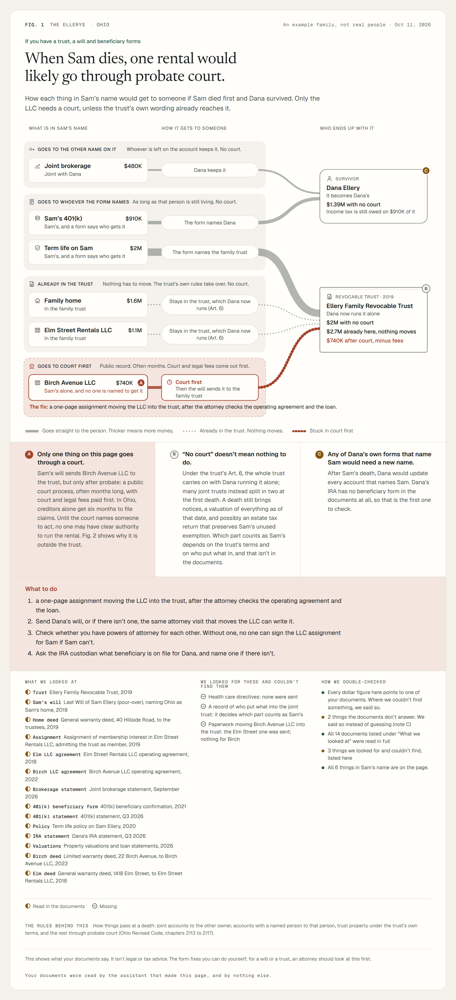
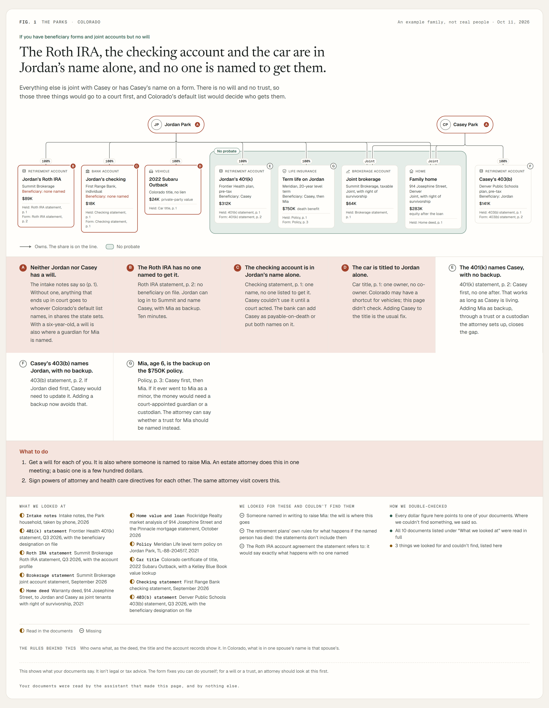

# belongs-to

**Hand it a family's documents. It draws who owns what, and where it goes when someone dies or a company sells. Every box says which page it came from. If the documents don't answer a question, the picture says so instead of making something up.**



Sam and Dana have a trust, two rental LLCs, a 401(k), and an attorney, a CPA and an advisor who have never been in the same room. Sam is fairly sure everything is in the trust. It isn't. One LLC was never moved in, and if Sam dies first, that building goes through probate court while everything else moves without a judge.

belongs-to reads the documents and draws that. Three drawings:

- **Whose name everything is in.** What the trust holds sits in one green zone. Anything that should be in it but isn't gets a red arrow that stops at the edge.
- **What happens when someone dies.** Each thing sits in the band of the mechanism that moves it: a joint account, a beneficiary form, the trust, or the will through probate court. Only the court band looks like a detour, because it is one.
- **What a sale does for QSBS.** For founders: which trust or person owns each block of stock, how much gain each of them can shelter, and which QSBS conditions the paperwork actually proves.

| | |
|---|---|
|  |  |

## What it won't do

It won't draw what it can't point to. Every card names the document and page it came from. If the paperwork doesn't say who gets the Roth, the card says "no one is named" in red, not "none." If a document was mentioned but never handed over, or was a scan it couldn't read, that shows up on the page too, under "What's missing."

Three limits. If it misreads a page, the drawing will be confidently wrong; that is why every card names its page, so you can check it in thirty seconds. It knows the general rules (how property passes at a death, the QSBS date bands) and says which situations it doesn't cover, such as community property and state probate shortcuts. And it never writes the fix: it tells you an assignment or a beneficiary form would close the gap, and your attorney writes it.

No human attorney has reviewed a real family's output yet; one real household has been through a blind AI attorney panel and a judge three times, scoring 4, then 6, then 7 out of 10, and each round's findings became checks in this release. The judge's verdict: a document map a careful attorney can work from, not yet a page a family relies on alone. How the examples were checked, and what the checks can and can't catch, is in [CONTRIBUTING.md](CONTRIBUTING.md).

## Your documents

With the standalone kit, your documents go to whatever model your agent already uses. The kit makes no network calls of its own. The eve version stores documents and session history as described below. Before you feed either version the real thing, try a redacted set, with names and account numbers blacked out, and check that the citations land on the right pages.

## Install

```bash
npx skills add silverstein/belongs-to
```

Or clone it into your agent's skills folder: `git clone https://github.com/silverstein/belongs-to ~/.claude/skills/belongs-to`. It needs Node 22 or newer, nothing to `npm install`, and Chrome or Chromium only if you want screenshots.

## Use

Tell your agent what you want in plain words:

> Here's our trust, our wills, the LLC agreements and last quarter's statements. Draw whose name everything is in, and what happens if I die first.

It writes down what it read and what it couldn't find, then gives you one HTML file per drawing that opens offline. Hover or tap a card to see what it holds and who holds it. On a phone the figures restack to fit.

Try the three example households first. None of them are real people.

```bash
node scripts/build.mjs examples/ellery/household.json   # a trust, two rental LLCs, one never moved in
node scripts/build.mjs examples/okafor/household.json   # founder stock, three trusts, QSBS caps
node scripts/build.mjs examples/park/household.json     # a 401(k), a Roth, a house, a car, and no will
```

The Park family is the ordinary case: two salaried people with "just" a 401(k) and an IRA. Claude, given only this skill and ten made-up documents, drew it in ten minutes and found seven things worth fixing, starting with the Roth IRA that names no one.



## Run belongs-to in eve

A map is only as useful as the papers behind it. In the eve chat, give the agent a folder and let it read the pages. It stops to ask when a document could change who owns something or who receives it. Leave the question open and the drawing shows the gap in red. Each document fact points to a page so you can open the papers and check it yourself.

Download the ownership view, the death view, and a QSBS ledger when the folder supports one. The download also includes a list of what to do and the model with its citations. Keep the files, open the HTML offline, or take them to an attorney or another AI.

Your own Vercel project runs the chat and sandbox. Document text stays in eve’s session history, and the uploaded files stay in the sandbox within your deployment. Vercel AI Gateway sends the text the agent reads to Anthropic Claude Sonnet 5.5 by default. If you set `BELONGS_TO_MODEL`, review the provider you choose before sharing documents. Start with the fictional folders.

[](https://vercel.com/new/clone?repository-url=https%3A%2F%2Fgithub.com%2Fsilverstein%2Fbelongs-to&root-directory=eve&env=BELONGS_TO_PASSWORD&project-name=belongs-to)

1. Import the repository with `eve` as its Root Directory. Enable **Include source files outside of the Root Directory in the Build Step** so eve can use the shared kit and examples.
2. Set `BELONGS_TO_PASSWORD` to a strong family password in the Vercel project. Anyone with it shares the same account for this deployment. The project needs Vercel Sandbox and AI Gateway access. Vercel project credentials can authenticate Gateway requests. Set `BELONGS_TO_MODEL` if you want a different Gateway model.
3. Open the app, enter the deployment password, and choose Ellery, Okafor, or Park. When the agent asks about missing papers, choose **Show the pages** to keep the gaps visible, or add the papers and start a fresh review.

For local development, use Node 24 and a running Docker engine. Set `AI_GATEWAY_API_KEY` in your shell for a live model, then run:

```sh
cd eve
npm ci
npm run dev
```

Open the URL printed by Vite. Use `npm run dev:agent -- --no-ui` to run the eve HTTP agent by itself. The folder picker accepts UTF-8 Markdown and text documents with unique filenames. Use headings such as `## Page 2` to preserve page numbers. A plain file without headings is page 1. Copy scans and PDFs to page-labelled text before uploading. The example buttons send the same fictional source files you can select under `examples/<family>/documents/`.

If the host runs out of file watchers, use the compiled agent with the same chat. Run `npm run build:eve`, then `EVE_DEV=1 npx eve start --host 127.0.0.1 --port 2000`. In a second terminal, run `EVE_BASE_URL=http://127.0.0.1:2000 npm run dev`.

### Check the examples

For a live preflight, start the compiled agent on port 2000 as above and run just the Park case from `eve/`.

```sh
npm run eval -- --url http://127.0.0.1:2000 --tag park --exclude-tag fixture --max-concurrency 1 --verbose
```

Run all three households once the preflight passes.

```sh
npm run eval -- --url http://127.0.0.1:2000 --exclude-tag fixture --max-concurrency 1
```

Each eve eval sends one folder, waits for a real eve question, answers it, and inspects the returned files. It checks the model with the kit and verifies page references and a set of known facts against the fictional papers. The kit's layout audit also has to pass before any file leaves the sandbox. Page numbers and the checked examples can catch real errors. A reader with the source in hand still checks whether every statement follows from its cited page.

To check the same sandbox, question and downloads without a model provider, create the separate fixture target. It supplies fixed model drafts so the test can isolate the rest of the flow.

```sh
cd eve
node scripts/fixture-target.mjs
(cd .eve-fixture && ../node_modules/.bin/eve build)
(cd .eve-fixture && EVE_DEV=1 ../node_modules/.bin/eve start --host 127.0.0.1 --port 4289)
```

With the fixture server running, use `npm run eval -- --url http://127.0.0.1:4289 --max-concurrency 1` from `eve/` in another terminal. This includes a regression that tries to name a Roth beneficiary without a source page. The live eval above measures whether the model can extract the facts from the source pages. From the repository root, run `eve/node_modules/.bin/tsc -p eve` for the type check.

## Export and share

```bash
node scripts/export.mjs out/first-death.html --png fig.png --svg fig.svg --social card.png
```

PNG at 2×, a standalone SVG that opens anywhere with the fonts built in, and a 1080-wide card for a feed. A link like `page.html#focus=birchllc` opens with one card and its connections lit up, so you can point someone at one finding.

## What it is not

It is a picture of what the documents say. It is not legal or tax advice, and an attorney or CPA should look at it before anyone acts on it. It draws structures and events, not cash flow, spending or projections. It covers US rules only.

## License

MIT for the code. The fonts (Newsreader and IBM Plex) are under the SIL Open Font License 1.1, in `kit/fonts/`.
