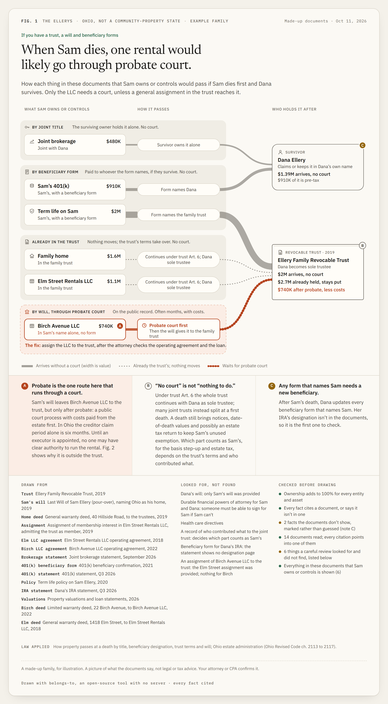
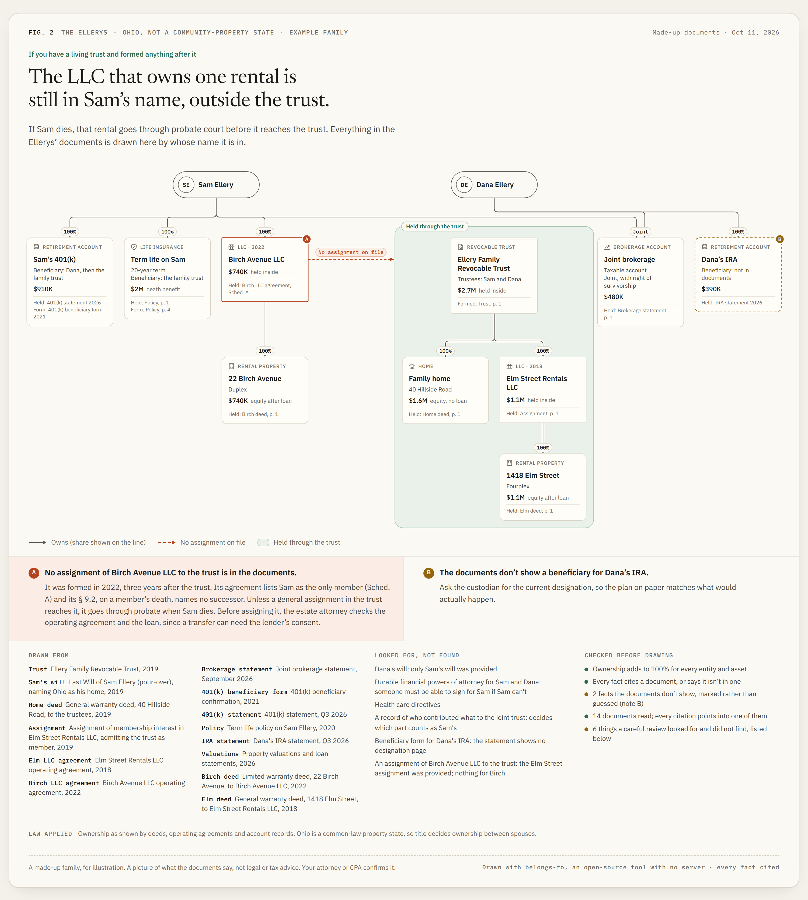
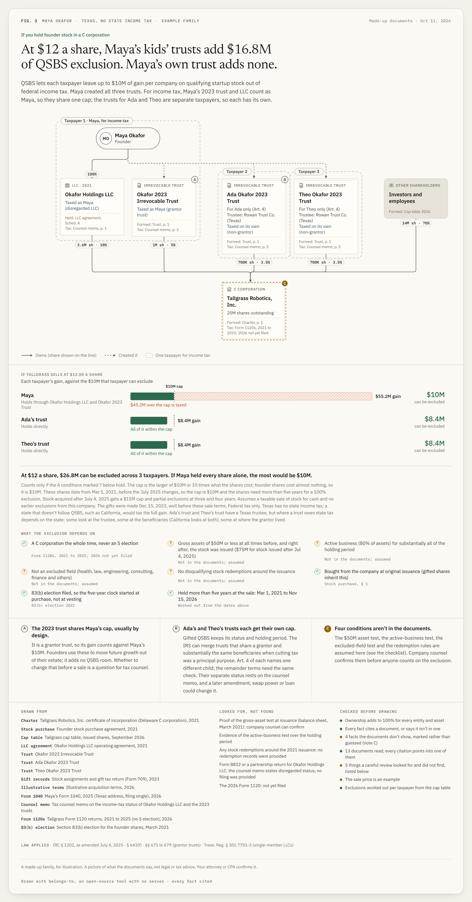
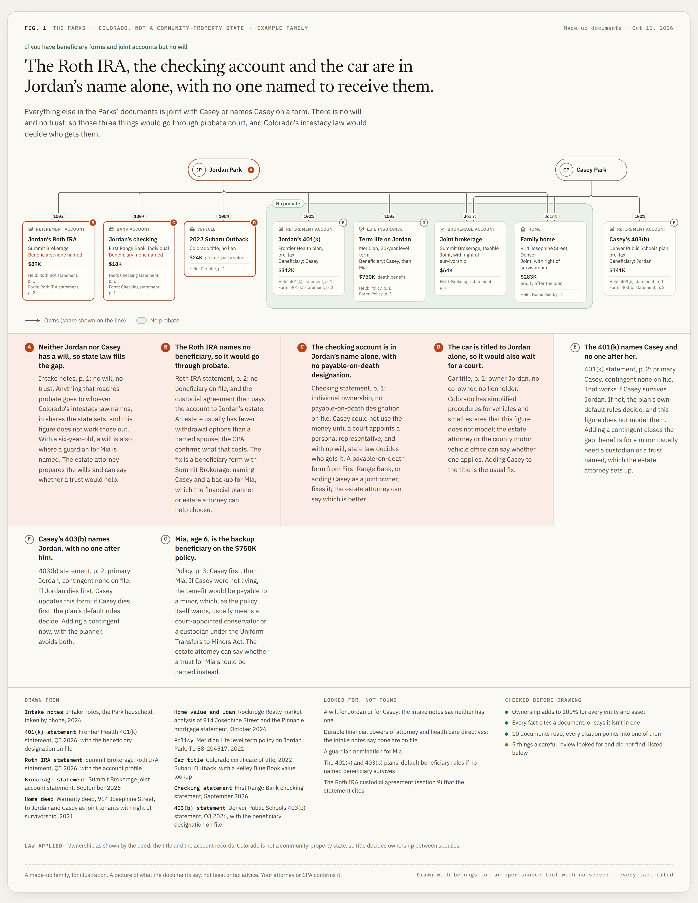

# belongs-to

**An agent skill that draws who owns what, and where it goes when something happens, from your own documents. Every box cites the page it came from, and anything the documents don't show is drawn as a gap, never guessed.**



Most people with a trust, a few LLCs and a stack of beneficiary forms can't see the whole picture. Their attorney, CPA and advisor each hold a piece. belongs-to reads the documents and draws three kinds of figures:

- **Whose name is everything in.** The trust's holdings sit in one zone. Anything that should be in the trust but isn't gets a red dashed arrow that stops at the zone's edge.
- **What happens when someone dies.** Each asset sits in the band of the mechanism that moves it: joint title, beneficiary form, the trust, or the will through probate. Only the court band looks like a detour, because it is one.
- **What a sale does for QSBS.** Holders are grouped by who answers for income tax. Each taxpayer's gain is set against that taxpayer's own § 1202 cap, and every eligibility condition is shown as cited or assumed.

| | |
|---|---|
|  |  |

## Why trust a picture of your estate plan

Because it checks itself before it draws, and it tells you what it couldn't check.

- **Every fact is cited.** A card says "Held: Birch deed, p. 1" or "Tax: Counsel memo, p. 2". A fact with no source fails the build.
- **Gaps are drawn, not filled in.** If the documents don't show a beneficiary, the figure says "not in the documents" in amber. It never says "none". The footer lists the documents a careful review would want and didn't get.
- **The numbers close.** Ownership adds to 100%, and cap tables add to the shares outstanding. Every dollar figure in a headline must match a number the model produces.
- **The law is explicit.** The rules the kit applies (death routing, § 1202 date bands, calendar holding periods, per-taxpayer caps) live in one file with their citations. `references/law.md` lists everything they don't cover, so a figure never implies more.
- **It was reviewed.** The examples went through two rounds of blind reads by a trusts-and-estates attorney persona, a founder, an operator household and a reader outside the audience, plus an independent statute check. Their objections became verifier rules. `scripts/test.mjs` breaks good models on purpose and proves the checks catch each break.

**What the checks cannot catch.** `scripts/redteam.mjs` attacks the audit with plausible wrong models. It catches every inconsistency it is built for (a headline figure off by a digit, ownership at 95%, an absence stated as fact, a missing state, a zone that contradicts tax ownership, a probate route with no note). It cannot see a citation to the right document but the wrong page, a value typed wrong from a statement, a beneficiary swapped for another real person, an asset left out entirely, or a trust labelled with the wrong tax status while citing a memo that says otherwise. The audit proves the figure agrees with the model. Whether the model agrees with the documents needs a reader with the documents open, which is why every card names its page.

It never drafts the fix. A figure names what would fix a gap ("assign the LLC to the trust, after the attorney checks the operating agreement and the loan") and who does it. It never writes the assignment, deed or form. Every figure says what it is: a picture of what the documents say, not legal or tax advice.

## What leaves your machine

The kit itself makes no network calls and has no server. Fonts are embedded, and the output is one offline HTML file. But the agent that reads your documents is a model. Whatever your agent sends to its model provider today, your documents go there too, and nowhere else. If that matters, try a redacted set first, check that the citations land on the right pages, and then decide.

## Install

```bash
npx skills add silverstein/belongs-to
# or clone into your agent's skills folder
git clone https://github.com/silverstein/belongs-to ~/.claude/skills/belongs-to
```

Requires Node 22 or newer. There is no npm install. Screenshots and the in-browser text checks need Chrome or Chromium (set `CHROME_PATH` if it isn't found).

## Use

Ask your agent in plain words:

> Here's our trust, our wills, the LLC agreements and last quarter's statements. Draw whose name everything is in, and what happens if I die first.

The agent writes a `household.json` from the documents, then builds and checks it:

```bash
node scripts/build.mjs path/to/household.json   # facts audit + layout audit, then HTML
node scripts/shoot.mjs out/first-death.html     # screenshot + text-overflow check (add --theme dark, --width 390)
node scripts/export.mjs out/first-death.html --png fig.png --svg fig.svg --social card.png   # PNG, standalone SVG, share card
node scripts/test.mjs                           # the audits' own tests
node scripts/redteam.mjs                        # what the audit catches and what it cannot
```

Each page is one offline HTML file. Hover or tap a card to trace what it holds and who holds it; `page.html#focus=birchllc` opens with that trace pinned, and `#note=A` marks a note, so a link can point at one finding. On a phone, the ownership tree and the transfer figure switch to stacked layouts designed at phone width: holdings nest under their holder with share chips, and the ribbons run down a gutter beside the cards. Both layouts pass the same layout audit as the wide ones.

Try the examples:

```bash
node scripts/build.mjs examples/ellery/household.json   # a trust, two rental LLCs, one never assigned
node scripts/build.mjs examples/okafor/household.json   # founder stock, three trusts, QSBS caps
node scripts/build.mjs examples/park/household.json     # a 401(k), a Roth, a house, a car and no will
```

The Park example is the skill's own dogfood: a fresh agent with only `SKILL.md` and the ten synthetic documents in `examples/park/documents/` built it in ten minutes, and both audits passed. Its seven findings (the Roth IRA names no one, the checking account has no payable-on-death designation, the car is titled to one spouse, no will, a six-year-old as contingent beneficiary on a $750K policy) are the ordinary kind that the salaried household with "just" a 401(k) and an IRA actually has.



## Files

- `SKILL.md`: the workflow the agent follows.
- `references/model.md`: the household model.
- `references/law.md`: the rules applied and their limits.
- `references/design.md`: the visual language.
- `kit/`: the model, the rules, the verifier, the renderers and the layout audit.
- `scripts/`: build, screenshot, test.

## Limits

- It covers US rules only, at the level of mechanism. Community property, state probate shortcuts, trust splits at a first death, per stirpes designations and mixed-regime QSBS lots are either flagged or refused, never guessed. `references/law.md` lists them all.
- It draws structures and events, not cash flows, projections or advice.
- The QSBS ledger (a bar chart) pans sideways on a phone; the ownership tree and the transfer figure restack into a phone-width layout.

## License

MIT for the code. Newsreader and IBM Plex are under the SIL Open Font License 1.1 (`kit/fonts/`).
