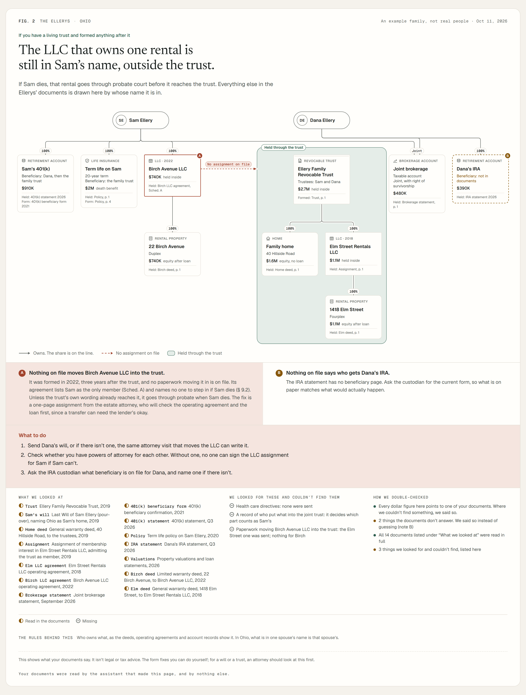
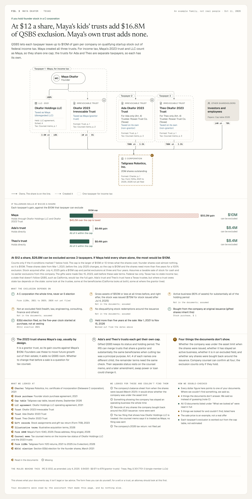

# belongs-to

**Hand it a family's documents. It draws who owns what, and where it goes when someone dies or a company sells. Every box says which page it came from. If the documents don't answer a question, the picture says so instead of making something up.**

Most agent demos show an agent doing more. In the eve demo, belongs-to shows what the papers leave unresolved. Each documented fact names its page. Missing answers appear as gaps, and eve draws the pages only after the family confirms.


Sam and Dana have a trust, two rental LLCs, a 401(k), and an attorney, a CPA and an advisor who have never been in the same room. Sam is fairly sure everything is in the trust. The papers show an assignment for Elm Street Rentals LLC and list Sam as the sole member of Birch Avenue LLC. On those papers, Birch Avenue LLC would go through probate if Sam dies first.

belongs-to reads the documents and draws that. Three drawings:

- **Whose name everything is in.** What the trust holds sits in one green zone. Anything that should be in it but isn't gets a red arrow that stops at the edge.
- **What happens when someone dies.** Each thing sits in the band of the mechanism that moves it: a joint account, a beneficiary form, the trust, or the will through probate court. Only the court band looks like a detour, because it is one.
- **What a sale does for QSBS.** For founders: which trust or person owns each block of stock, how much gain each of them can shelter, and which QSBS conditions the paperwork actually proves.

| | |
|---|---|
|  |  |

## What the checks cover

Every card names the document and page it came from. An empty beneficiary field supports a finding that no one is named. A missing beneficiary form leaves the answer open. The page also lists documents that were mentioned but absent or could not be read.

The kit checks ownership totals, rules, and layout against the household model. Eve also checks that cited pages were read, that literal dollar amounts appear on those pages, and that a cited page contains the names used for beneficiaries and owners. A page reporting no named beneficiary cannot support a name for that designation. For equity calculated from an appraisal and a loan, eve checks the two amounts and the subtraction. Other expressly explained derived or estimated values rely on the agent's explanation.

A matching name or number can refer to a different role, asset, date, or amount on the same page. The checks cannot establish those relationships or decide whether the documents are complete or current. Open the cited page to check the meaning. The kit applies general US transfer mechanisms and federal QSBS rules. A missing state leaves transfers that depend on state law open. Bring the pages to an attorney or CPA for the legal or tax decision and any documents that need to be drafted.

No human attorney has reviewed a real family's output yet; one real household has been through a blind AI attorney panel and a judge three times, scoring 4, then 6, then 7 out of 10, and each round's findings became checks in this release. The judge's verdict: a document map a careful attorney can work from, not yet a page a family relies on alone. How the examples were checked, and what the checks can and can't catch, is in [CONTRIBUTING.md](CONTRIBUTING.md).

## Your documents

With the standalone kit, your documents go to whatever model your agent already uses. The kit makes no network calls of its own. The eve version stores documents and session history as described below. Before you feed either version the real thing, try a redacted set, with names and account numbers blacked out, and check that the citations land on the right pages.

## Install

```bash
npx skills add silverstein/belongs-to
```

Or clone it into your agent's skills folder: `git clone https://github.com/silverstein/belongs-to ~/.claude/skills/belongs-to`. It needs Node 22 or newer, nothing to `npm install`, and Chrome or Chromium only if you want screenshots.

## Use

Tell your agent what you want in plain words:

> Here's our trust, our wills, the LLC agreements and last quarter's statements. Draw whose name everything is in, and what happens if I die first.

It writes down what it read and what it couldn't find, then gives you one HTML file per drawing that opens offline. Hover or tap a card to see what it holds and who holds it. On a phone the figures restack to fit.

Try the three example households first. None of them are real people.

```bash
node scripts/build.mjs examples/ellery/household.json   # a trust, two rental LLCs, one never moved in
node scripts/build.mjs examples/okafor/household.json   # founder stock, three trusts, QSBS caps
node scripts/build.mjs examples/park/household.json     # a 401(k), a Roth, a house, a car, and no will
```

The Park family is the ordinary case: two salaried people with "just" a 401(k) and an IRA. Claude, given only this skill and ten made-up documents, drew it in ten minutes and found seven things worth fixing, starting with the Roth IRA that names no one.


## Run belongs-to in eve

A map is only as useful as the papers behind it. In the eve chat, give the agent a folder and let it read the pages. It stops to ask when a document could change who owns something or who receives it. Leave the question open and the drawing shows the gap in red. Each document fact points to a page so you can open the papers and check it yourself.

Download the ownership view, the death view, and a QSBS ledger when the folder supports one. The download also includes a list of what to do and the model with its citations. Keep the files, open the HTML offline, or take them to an attorney or another AI.

Your own Vercel project runs the chat and sandbox. Document text stays in eve’s session history, and the uploaded files stay in the sandbox within your deployment. Vercel AI Gateway sends the text the agent reads to Anthropic Claude Sonnet 5.5 by default. If you set `BELONGS_TO_MODEL`, review the provider you choose before sharing documents. Start with the fictional folders.

[](https://vercel.com/new/clone?repository-url=https%3A%2F%2Fgithub.com%2Fsilverstein%2Fbelongs-to&root-directory=eve&install-command=npm%20ci&build-command=npm%20run%20build&env=BELONGS_TO_PASSWORD&project-name=belongs-to)

1. Use the button to create a Vercel project from the full repository. The button selects `eve` as Root Directory, `npm ci` for install, and `npm run build` for build. Use Node.js 24.x and keep the build output setting at its default so the Eve Vite plugin can assemble the web app and agent service. [Vercel Deploy Button build settings](https://vercel.com/docs/deploy-button/build-settings)
2. Keep **Include source files outside of the Root Directory in the Build Step** enabled under **Build and Deployment**. Vercel enables it by default on new projects. The install step in `eve` reads the kit, examples, and references from the same repository. Enable the setting before building if reusing a project where it was turned off. [Vercel monorepo settings](https://vercel.com/docs/monorepos/monorepo-faq#can-i-share-source-files-between-projects-are-shared-packages-supported)
3. Set `BELONGS_TO_PASSWORD` to a long, unique password. This shared password has no attempt limit, and everyone with it shares the deployment's account. Vercel supplies project credentials for Sandbox and AI Gateway on hosted deployments. Eve prepares the Sandbox snapshot during the build. Set `BELONGS_TO_MODEL` to choose another Gateway model.
4. Open the app and enter the family password to enable the example buttons and folder picker. At the review question, choose **Show the pages** to leave the gaps visible. If you choose **I have another document**, you can start with the complete folder or ask to continue this review and choose **Show the pages**.

For local development, use Node 24 and a running Docker engine. Set `AI_GATEWAY_API_KEY` in your shell for a live model, then run:

```sh
cd eve
npm ci
npm run dev
```

Open the URL printed by Vite. Use `npm run dev:agent -- --no-ui` to run the eve HTTP agent by itself. The folder picker accepts UTF-8 Markdown and text documents with unique filenames. Use headings such as `## Page 2` to preserve page numbers. A plain file without headings is page 1. Copy scans and PDFs to page-labelled text before uploading. The example buttons send the same fictional source files you can select under `examples/<family>/documents/`.

If the host runs out of file watchers, use the compiled agent with the same chat. Run `npm run build:eve`, then `EVE_DEV=1 npx eve start --host 127.0.0.1 --port 2000`. In a second terminal, run `EVE_BASE_URL=http://127.0.0.1:2000 npm run dev`.

### Check the examples

From `eve/`, run `npm run check:hosted` to compile the agent for Vercel and check that the generated web function returns ready from `/eve/v1/health`. The check uses a temporary build and skips sandbox prewarming, so it needs no Vercel credentials.

For a live preflight, start the compiled agent on port 2000 as above and run just the Park case from `eve/`.

```sh
npm run eval -- --url http://127.0.0.1:2000 --tag park --exclude-tag fixture --max-concurrency 1 --verbose
```

Run all three households once the preflight passes.

```sh
npm run eval -- --url http://127.0.0.1:2000 --exclude-tag fixture --max-concurrency 1
```

Each eve eval sends one folder, answers the review confirmation, and inspects the returned files. It checks literal evidence on cited pages and verifies specific known facts against the fictional papers. Both audits pass before the family is asked, and pages are drawn after confirmation. Layout edits reuse the answer when the facts, gaps and wording stay the same. Changing a headline, note or task asks the family to confirm again.

The chat shows which documents were read, which checks passed, and what the agent had to repair. After confirmation, the pages open inline. Each page can also be expanded or saved as an offline HTML file.

Set `BELONGS_TO_PACKET_DIR` to an absolute directory when running the eval to save its downloadable files under the session and review call IDs. To recover files from a saved Eve case, run `node scripts/export-packet.mjs <eval-case.json> <output-directory>` from `eve/`. The saved HTML includes its fonts and opens offline.

To check the same sandbox, question and downloads without a model provider, create the separate fixture target. It supplies fixed model drafts so the test can isolate the rest of the flow.

```sh
cd eve
node scripts/fixture-target.mjs
(cd .eve-fixture && ../node_modules/.bin/eve build)
(cd .eve-fixture && EVE_DEV=1 ../node_modules/.bin/eve start --host 127.0.0.1 --port 4289)
```

With the fixture server running, use `npm run eval -- --url http://127.0.0.1:4289 --max-concurrency 1` from `eve/` in another terminal. The fixtures cover a missing title, intake answers, bad names and amounts on real pages, layout repairs, renewed confirmation after a headline or fact changes, and choosing to proceed after asking to add a document. The live eval measures whether the model extracts the expected facts and returns a checked packet. From the repository root, run `eve/node_modules/.bin/tsc -p eve` after `npm ci` in `eve/`.

The Chrome sign in check takes two loopback Vite URLs. Point the first at a compiled fixture started with `BELONGS_TO_PASSWORD=round10-fictional-fixture` and point the second at a fixture started with `EVE_DEV=1` and an empty password. Set the same password setting on each Vite process. Run `node scripts/check-browser-auth.mjs <protected-url> <local-url>` from `eve/` with Playwright available. You can set `BELONGS_TO_PLAYWRIGHT` to a local Playwright module path.

## Export and share

```bash
node scripts/export.mjs out/first-death.html --png fig.png --svg fig.svg --social card.png
```

PNG at 2×, a standalone SVG that opens anywhere with the fonts built in, and a 1080-wide card for a feed. A link like `page.html#focus=birchllc` opens with one card and its connections lit up, so you can point someone at one finding.

## What it is not

It is a picture of what the documents say. It is not legal or tax advice, and an attorney or CPA should look at it before anyone acts on it. It draws structures and events, not cash flow, spending or projections. It covers US rules only.

## License

MIT for the code. The fonts (Newsreader, Geist Sans and Geist Mono) are under the SIL Open Font License 1.1, in `kit/fonts/`.
